  

  

<h3 align="center">🔗 تابعني</h3>

  
  
  
  
  

  

---

### 🧑‍💻 عنّي
- 🎥 صانع محتوى **فورتنايت وماين كرافت** على يوتيوب، وهدفي **100 ألف مشترك** 🎯
- 🛒 مؤسس متجر **بيكسل برو** للكتب الإلكترونية والأدوات للقيمرز
- 📊 طالب **إدارة أعمال**
- 🌐 أبني مواقع عربية بـ HTML و CSS و JavaScript
- 🐍 الخطوة الجاية: **Python** وتطبيق ذكاء اصطناعي

<h3 align="center">🎮 جهازي</h3>

  
  
  
  
  
  

<h3 align="center">🛠️ الأدوات والتقنيات</h3>

  

  
  
  
  
  

### 📌 مشاريعي
| المشروع | الوصف | التقنية |
|---|---|---|
| 🖤 **أبنوس** | متجر ماركات عربي فاخر | HTML · CSS · JS |
| 💚 **رابح** | منصة لصنّاع المحتوى يبيعون أونلاين | HTML · CSS · JS |
| 🎮 [**onigames.com**](https://github.com/oni68real/onigames.com) | موقع ألعاب | HTML |
| 📚 [**بيكسل برو**](https://pixelprosa.com) | متجر كتب إلكترونية للقيمرز وصناع المحتوى | Zid |

<h3 align="center">📈 إحصائياتي</h3>

  

  

  

